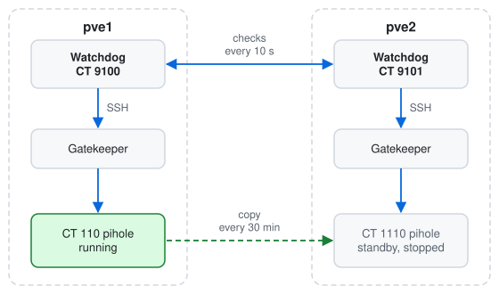
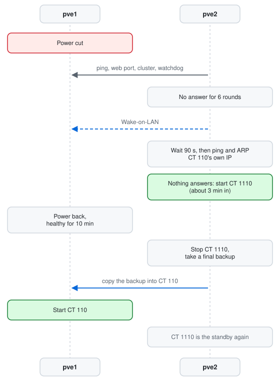
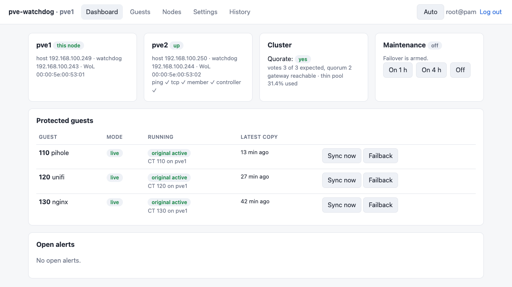
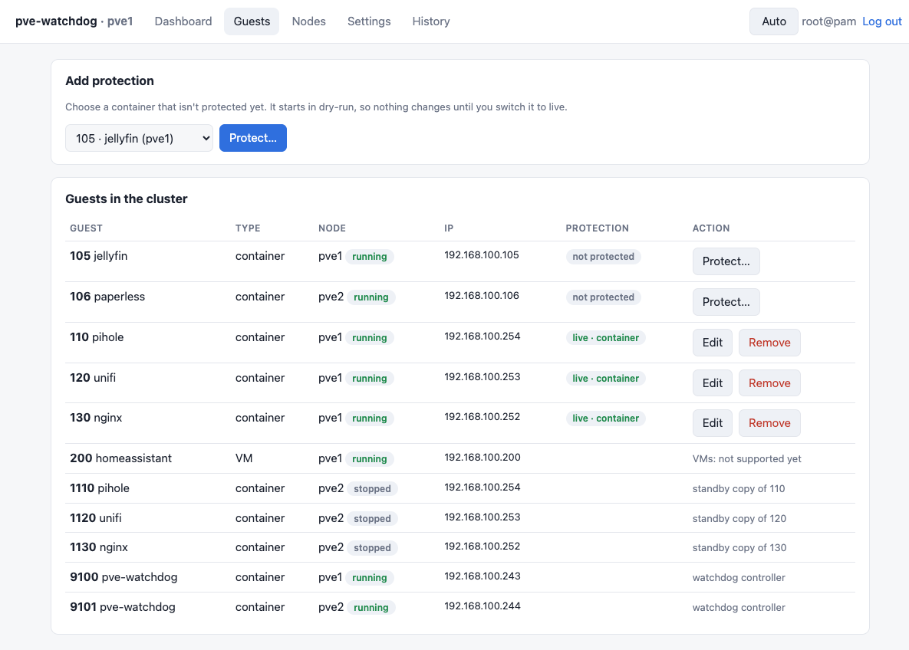

# pve-watchdog

[](https://github.com/rob-paprocki/pve-watchdog/releases/latest)
[](https://github.com/rob-paprocki/pve-watchdog/actions/workflows/ci.yml)
[](LICENSE)
[](https://www.proxmox.com/en/proxmox-virtual-environment)

Failover for the LXC containers you can't do without, on a small Proxmox VE
cluster that only has local disks.

When the node running one of them dies, another node starts a copy with the
same MAC address and IP, so DNS settings, DHCP reservations and bookmarks keep
pointing at the right place.
When the first node is healthy again, the container moves back, together with
everything that changed while it was away.

On each Proxmox node, as root:

```bash
bash -c "$(curl -fsSL https://github.com/rob-paprocki/pve-watchdog/releases/latest/download/get.sh)"
```

Everything starts in dry-run, so nothing changes until you say so. Details are under [Installation](#installation).

## Highlights

- Runs on plain local LVM-thin storage. No ZFS, no shared storage, no QDevice.
- The copy keeps the original's MAC and IP. A Pi-hole or a reverse proxy stays
  at the same address after a failover.
- A standby container starts in about two seconds. Most of the roughly three
  minutes before it does is deliberate waiting, to be sure the node is really gone.
- Moving back loses nothing: the standby is stopped first and its data is
  copied into the original before the original starts.
- It would rather do nothing than start a second copy. Before starting one it
  pings and ARPs the container's own IP, and everything starts in dry-run.
- A web UI on every node (Proxmox login), Discord alerts, Wake-on-LAN for a node
  that went down, and maintenance mode that switches itself on for normal reboots.

## Overview

Proxmox has HA built in, but it needs shared or replicated storage and fences
nodes with a hardware watchdog. Plenty of two- and three-node home and small-office
clusters have neither, just one SSD per box. pve-watchdog covers that gap for
the handful of containers whose downtime you'd notice.

Each node gets a small watchdog container. The watchdogs check on each other
every 10 seconds, keep a fresh copy of every protected container on the other
node, and decide when to take over or hand back. They never run Proxmox
commands themselves; a gatekeeper script on each host does, and it re-checks
every safety rule before it acts.

<table width="100%">
<tr>
<th width="50%">What runs where</th>
<th width="50%">A power cut on pve1, start to finish</th>
</tr>
<tr>
<td width="50%" valign="top">

<picture>
  <source media="(prefers-color-scheme: dark)" srcset="docs/images/diagram-architecture-dark.svg">
  
</picture>

</td>
<td width="50%" valign="top">

<picture>
  <source media="(prefers-color-scheme: dark)" srcset="docs/images/diagram-timeline-dark.svg">
  
</picture>

</td>
</tr>
</table>

Each watchdog's SSH key can run only its own node's gatekeeper script, and
both read one shared config file in `/etc/pve`.


There's no fencing, so this is less airtight than Proxmox HA. Read the [list of
ways it can still go wrong](docs/how-it-works.md#what-can-still-go-wrong) before
you switch anything to live; it's short.

### Author

Written by [rob-paprocki](https://github.com/rob-paprocki) for small Proxmox
clusters where shared storage isn't on the table.

## Installation

You need Proxmox VE 8 or 9, a cluster of two or more nodes on one LAN, LVM-thin
local storage, one free container ID and one free static IP per node, and
internet access on the hosts while installing.

Run the command at the top as root on the first node. `get.sh` downloads the
release, checks it against `SHA256SUMS` and starts a short wizard. The wizard
finds the nodes and the gateway on its own, asks which container ID and IP the
watchdog should get, and writes a config in dry-run mode. Run the same command
on each other node and it joins the existing config.

To pin a version, take `get.sh` from that release's page instead of "latest".

## Usage

Open `https://<watchdog-ip>:8443`, sign in with a Proxmox admin account and
protect a container on the Guests tab. Every node's Notes panel in Proxmox also
gets a link to it. New protection starts in dry-run; the
[go-live steps](docs/how-it-works.md#going-live-one-container-at-a-time) cover
switching it on.

<picture>
  <source media="(prefers-color-scheme: dark)" srcset="docs/images/webui-dashboard-dark.png">
  
</picture>

The Guests tab lists everything in the cluster and is where you protect a container:

<picture>
  <source media="(prefers-color-scheme: dark)" srcset="docs/images/webui-guests-dark.png">
  
</picture>

From any node's shell:

```text
$ pve-watchdog status
node pve2   mode: LIVE   maintenance: off
cluster: quorate=True expected=3 total=3 quorum=2 members=pve1,pve2
gateway reachable: True   thin pool: 31.4% used
peer pve1         controller: reachable

CT     name         mode     registered on  status    my copy
110    pihole       live     active: original (CT 110 on pve1) | here: CT 1110 stopped, copy 12 min old
120    unifi        live     active: original (CT 120 on pve1) | here: CT 1120 stopped, copy 26 min old
```

This is what pve1 losing power looks like in Discord:

```text
pve2  pve1 is DOWN (no ping, no web UI, not in cluster, no controller for 6 rounds). Takeover in 90s unless it returns.
pve2  sent Wake-on-LAN to pve1 (00:00:5e:00:53:01), try 1 of 6
pve2  ⚠️ ENTERING FORCE MODE: running `pvecm expected 1` so this node can act alone while pve1 is down.
pve2  started CT 1110 (pihole) in place of CT 110 on pve1; copy was 12 min old
pve2  pve1 is reachable again (ping, tcp, member)
pve2  starting failback: stopping CT 1110, then starting CT 110 on pve1 (short outage)
pve2  CT 110 is back on pve1; CT 1110 is the standby again
```

| Command | What it does |
|---|---|
| `pve-watchdog status` | Nodes, quorum, which copy of each container is active, copy age, open alerts |
| `pve-watchdog plan` | A dry rehearsal of what would happen if another node died now |
| `pve-watchdog maintenance on 2h` / `off` | Pause failover (normal reboots do this by themselves) |
| `pve-watchdog sync --now [ID]` | Refresh the copies now |
| `pve-watchdog failback ID` | Move a container back to its preferred node |
| `pve-watchdog wake NODE` | Send a node a Wake-on-LAN packet |

[How it works](docs/how-it-works.md) has the full design: the takeover and
failback steps, the safety switches, every failure mode, and how to uninstall.

## Feedback and contributing

Bugs, and failure modes the docs don't cover, belong in the
[issues](https://github.com/rob-paprocki/pve-watchdog/issues). Releases are built
from a separate development repository, so fixes sent here get copied over by
hand and ship in the next version.

The offline test suite needs no Proxmox:

```bash
PYTHONPATH=controller python3 -m unittest discover -s tests
```

## Licence

GPL-3.0. See [LICENSE](LICENSE).
