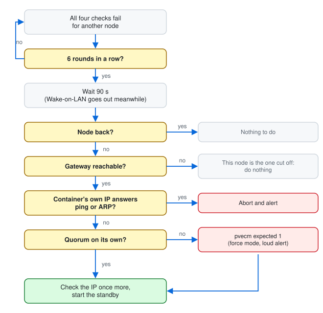

# How pve-watchdog works

The full picture behind the [README](../README.md): what runs where, what happens
when a node dies or comes back, the safety rules, and the ways it can still fail.

## The moving parts

### The pieces

| Piece | Where | What it does |
|---|---|---|
| **Watchdog container** | One small container per node (e.g. CT 9100 / 9101), pinned to its node | Checks on the other nodes, decides when to take over or move back, keeps the standby copies fresh, serves the web UI. Every node runs the same code; no node is in charge. |
| **Gatekeeper** (`/usr/local/sbin/pve-watchdog-hostcmd`) | On each Proxmox host | The only part that runs Proxmox commands. The watchdog reaches it over SSH with a key that can run only this script, and only from the watchdog's IP. It has a short list of actions and re-checks every safety rule itself. |
| **Shared config** (`/etc/pve/pve-watchdog/config.toml`) | Proxmox's cluster filesystem | One file seen by every node, readable even without quorum. |
| **Secret file** (`/etc/pve/priv/pve-watchdog.secret.toml`) | Root-only part of the cluster filesystem | Discord webhook and the key the watchdogs sign their messages with. |

### Two kinds of standby (per container)

Proxmox doesn't allow two containers with the same ID in one cluster, so a
standby either gets its own ID or isn't a container at all:

* `standby = "container"` (recommended): a true duplicate. The standby is a
  real, stopped container on the other node with ID original + 1000
  (101 → 1101), the same MAC and IP, `onboot 0`, and the tag
  `pve-watchdog-standby`. Every interval, the node running the active copy backs
  it up, sends the backup over, and the standby is refreshed from it. A
  takeover just starts the standby, which takes seconds. Refreshing rewrites
  the standby's whole disk, so choose longer intervals for big containers to
  spare the SSD.
* `standby = "file"`: a backup file. The other node keeps the latest backup
  file. A takeover moves the container's config to the surviving node and
  restores it under the same ID. It takes a few seconds to a minute longer,
  and uses no disk in the thin pool until it's needed.

`/etc/pve/pve-watchdog/roles.json` records which copy of each container is the
active one, so after any reboot only that copy is started.

### When a node dies (takeover)

Every 10 seconds each watchdog checks each other node four ways: ping, the
Proxmox web port, cluster membership and the other watchdog. Then:

<picture>
  <source media="(prefers-color-scheme: dark)" srcset="images/diagram-decisions-dark.svg">
  
</picture>

Step by step:

1. A node counts as down only after 6 rounds in a row where all four
   checks failed. Any single answer resets the count.
2. The watchdog waits another 90 seconds (`failover_delay`).
3. It checks that it can still reach the gateway. If it can't, it's probably
   the one that's cut off, so it does nothing.
4. For each container on the dead node (highest priority first) it checks the
   container's own IP with ping and ARP. If something answers, the container
   is alive somewhere, so it aborts and alerts.
5. If this node has no quorum on its own, it runs `pvecm expected 1`
   ("force mode"), waits for quorum, and sends a loud alert. A node that keeps
   quorum alone (for example one given 2 votes in a two-node cluster) never
   needs this.
6. It starts the standby, or restores the backup file, after checking once
   more that nothing answers on the container's IP.

Expect about 3 minutes from the failure until the container answers again,
almost all of it the deliberate waiting above. A takeover uses the last copy,
so you lose at most one interval of changes (30 minutes by default).

### When the original node comes back (failback)

With `failback = "auto"`, once the original node has been healthy for
10 minutes:

1. the running standby is stopped first,
2. a final backup of it is taken while stopped, so nothing is lost,
3. that backup is copied back into the original,
4. then the original is started, and the standby goes back to waiting.

Each move back means about a minute of downtime for that container. If anything
fails part-way, the standby is started again and you get an alert.
`failback = "manual"` alerts you and waits for `pve-watchdog failback <ID>`;
`failback = "never"` keeps the new placement.

### Other safeguards

* A cut-off node stops its own copies. A node that can reach neither the
  gateway nor any other node for 2 minutes stops its protected containers, so
  the others can take over without two copies running. When its network
  returns it restarts them, unless the other copy is now active.
* Boot arbitration. Protected containers get `onboot 0`, so Proxmox never
  starts them by itself. After a host boots, its watchdog starts only the copies
  that are marked active, and only if nothing already answers on their IP.
* Wake-on-LAN. A node that is down may simply be switched off. Its partner
  sends it a magic packet after 60 seconds, then every 5 minutes, up to 6 times
  (never during maintenance). Set `wol_mac` per node; the BIOS must allow
  wake from the network card.
* Maintenance mode. A normal reboot or shutdown turns maintenance on for
  20 minutes by itself (`pve-watchdog-planned-shutdown.service`). A crash or
  power cut doesn't, so real failures still fail over. For longer work:
  `pve-watchdog maintenance on 2h`. It always switches itself off again.
* Alerts go to a Discord webhook: once when a problem starts, once when it
  clears, queued while the internet is down.

## Safety switches

Nothing changes anywhere unless all three are true:

1. `dry_run = false` in the config,
2. the file `/etc/pve-watchdog/allow-live` exists on that host (you create it by hand),
3. the container's entry says `mode = "live"`.

Otherwise every action is only logged as `DRY-RUN would run: …`, together with
the result of every safety check. `pve-watchdog plan` always runs in dry-run.

Limits enforced in the gatekeeper's code:

* It acts only on containers listed in the config (and their standbys). Its own
  watchdog containers and VMs are refused.
* It never starts a container whose IP already answers, never takes over from a
  node that still pings or is still in the cluster, never overwrites the active
  copy, and never force-quorums while the other node still answers.
* It refuses restores that would fill the thin pool past 80%.
* It lifts Proxmox's `protection` flag only on its own tagged standby, or on an
  original while that original is being failed back to.
* Configs (including ones saved from the web UI) must pass a strict schema:
  known keys only, with types, ranges and paths checked.
* It never touches corosync.conf, votes, storage.cfg, partitions, the LVM
  layout, hostnames or cluster membership. `pvecm expected 1` is a temporary
  runtime setting and the only quorum command it uses.

Logs: `/var/log/pve-watchdog-hostcmd.log` on each host, and
`journalctl -u pve-watchdog` inside each watchdog container.

## Failure modes

| Situation | What happens |
|---|---|
| A node dies or loses power | The others take over its protected containers after about 3 minutes, forcing quorum if needed, and try to wake it. |
| Planned reboot or shutdown | Maintenance switches on by itself for 20 minutes, so nothing moves. |
| Cluster link broken, nodes still on the LAN | Ping and the web port still answer, so nothing happens. If those fail too, the containers' own IPs still answer and the takeover is aborted. |
| A node completely cut off | It stops its own protected containers after 2 minutes; the others take over. |
| Router/gateway dies, nodes fine | The nodes still see each other: nothing happens. |
| Copy interrupted part-way | The previous good copy stays; the next run succeeds. |
| Thin pool too full | The copy isn't sent and restores are refused (both alerted). |
| Node returns during the waiting period | The takeover is cancelled. |
| Both copies seen running | Loud alert; the tool touches neither. Stop one by hand. |
| Connection drops during a failback | The tool watches for up to 15 minutes to see which copy became active, and only restarts the standby if none did. |
| A liveness check can't run | Treated as "alive", which blocks the takeover. |

## What can still go wrong

The failure that matters is two running copies with the same MAC and IP. For a
DHCP or DNS server that's as bad as it gets. These are the ways it can still happen,
plus a few smaller sharp edges:

* A partial network fault. If one node keeps quorum on its own and is cut
  off from the other node but not from the gateway (say, a fault between the
  two switch ports only), the other node may force quorum and start copies.
  When the network heals, two copies are running and the cluster filesystem has
  to reconcile two views. pve-watchdog alerts and touches neither; you stop one.
* The liveness check needs the container on the network. A container that
  is running but answers neither ping nor ARP looks dead.
* Force mode is real. While a node runs with `expected 1` it is a cluster
  of one, and Proxmox's protection against conflicting changes is off until the
  other node rejoins.
* Data loss window. A takeover uses the last copy (up to one interval old).
  Failback loses nothing.
* Clocks. The watchdogs reject messages more than 60 seconds old; keep NTP
  working.
* Passed-through devices (USB, serial) don't follow a container to another node.

I haven't settled whether a QDevice (a small third voter on another machine)
belongs here. It would let the surviving node keep real quorum instead of forcing
it, at the cost of a third box. Today pve-watchdog neither needs nor sets one up.

## Going live, one container at a time

1. Protect a container in the UI. It starts in dry-run; check the Dashboard
   and `pve-watchdog plan`.
2. Set `dry_run = false` (Settings), and `touch /etc/pve-watchdog/allow-live`
   on every host.
3. Switch that container to live. Within a minute its `onboot` is set to 0,
   and the first copy (or standby) is created on the other node.

## Uninstall

On each host: `pct exec <watchdog-id> -- systemctl disable --now pve-watchdog
pve-watchdog-sync.timer`, remove the `pve-watchdog-controller-…` line from
`/root/.ssh/authorized_keys2`, `systemctl disable --now
pve-watchdog-planned-shutdown pve-watchdog-wol`, and delete
`/usr/local/sbin/pve-watchdog*`. Then, if you like, `pct destroy` the watchdog
containers and the standbys, and delete `/etc/pve/pve-watchdog`. Set `onboot 1`
again on containers you want Proxmox to start by itself.
